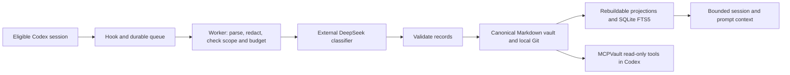

# Agent Memory Vault

Local-first persistent memory and context retrieval for Codex coding sessions.

Coding agents lose decisions, constraints, and operational context between sessions.
Agent Memory Vault turns eligible session transcripts into source-cited Markdown
records, then supplies bounded context at session start and before later prompts.
Markdown is the source of truth; the SQLite search index and navigation views are rebuildable.

## Implemented capabilities

- Codex lifecycle adapters for `SessionStart`, `SessionEnd`, `PreCompact`, and `UserPromptSubmit`.
- Project allowlists, transcript parsing, redaction, a durable file queue, and a background worker.
- DeepSeek classification into validated memory records, estimated spend accounting, and budget pausing.
- Obsidian-compatible notes, local Git history, audit events, supersession, and deterministic projections.
- Local SQLite FTS5/BM25 retrieval with scope, validity, file-count, and context-budget filters.
- An installer-configured, read-only Codex tool allowlist for the pinned third-party MCPVault server.

## Architecture and data flow



`SessionStart` selects global/project memory and an expiring project handoff.
`UserPromptSubmit` retrieves a prompt-relevant pack locally. `PreCompact` queues
a continuity checkpoint; it does not perform classification synchronously.
Canonical writes go through the worker pipeline rather than the MCP read tools.
See [the pipeline contract](docs/05-memory-pipeline-contract.md) and
[the technical specification](docs/02-technical-spec.md), which also describe intended behavior.

## Requirements

Python 3.14+, `uv`, Git, and a SQLite build with FTS5. The current installer targets
Linux with user-level systemd and a compatible Codex lifecycle-hook configuration.
Node.js 20+ and `npx` are needed for `@bitbonsai/mcpvault@0.12.4`.
Obsidian is optional. Automatic extraction requires a configured DeepSeek API key.

## Install with explicit local paths

```bash
git clone https://github.com/brunocaxias/agent-memory-vault.git
cd agent-memory-vault
uv sync --extra dev
mkdir -p "$HOME/.config/agent-memory-vault"
cp config/config.example.toml "$HOME/.config/agent-memory-vault/config.toml"
```

Before installation, edit that TOML file: set `vault_root` to a separate, private
vault and replace `allowed_project_roots` with directories you explicitly approve.
Use absolute paths you own; do not reuse the author's `/mnt/Dump/...` defaults.
Configure `denied_roots` for excluded directories. Check the classifier model,
endpoint, cost estimates, and monthly cap against your own provider account.
The example prices and model identifier are configuration values, not a current service guarantee.

```bash
uv run memory-vault install --config "$HOME/.config/agent-memory-vault/config.toml"
```

The installer initializes the separate vault and its local Git repository, writes
user hooks, systemd service/timer files, and MCP configuration, and disables Codex's
native generated memories. Existing configuration files receive timestamped backups.
Review these changes and the paths printed by the installer before enabling the worker.
Keep this checkout and its virtual environment at a stable path: hooks reference its executables.

The worker waits for `DEEPSEEK_API_KEY` in the environment file printed by the
installer. Keep that file outside Git and mode `0600`. Restart Codex after
configuration; inspect the server with `codex mcp get agent_memory_vault` if supported
by your installed Codex version. See [operations](docs/06-operations-runbook.md)
for service management and recovery. Do not copy the checked-in hook/unit templates
unchanged: they also contain machine-specific paths.

## Operational examples

```bash
uv run memory-vault status
uv run memory-vault validate
uv run memory-vault rebuild-projections
uv run memory-vault curate
```

These use the default XDG config path above; each subcommand also accepts `--config`.
`curate --write-report` writes a proposal-only maintenance report when findings exist.
After reviewing its unit, the optional daily timer can be enabled with
`systemctl --user enable --now agent-memory-vault-curator.timer`.

For example, a completed approved project session can contribute a validated
architecture decision. A later session in that project can retrieve the active
record without loading the entire transcript. This describes the implemented
pipeline, not a measured retrieval-quality result.

## Privacy and security boundaries

Storage and retrieval are local, but **automatic classification sends a redacted
transcript excerpt to the configured external provider**. Redaction is a safeguard,
not proof that sensitive information cannot leave the machine. Restrict eligible
projects and review the classifier input policy before enabling extraction.

The MCP read allowlist is enforced by the Codex configuration; it is not a filesystem
sandbox. The vault, queue, audit files, handoffs, search database, backups, and local
Git history can contain private context. Protect them together, keep them out of
public repositories, and review any backup command. No remote vault push is required.

## Development and tests

```bash
uv sync --extra dev
uv run pytest
uv run ruff check .
```

Tests cover configuration, eligibility, transcript redaction, queues, hooks,
selection, validation, Git operations, and mocked classifier/installer behavior.
They do not establish live provider reliability or universal Codex compatibility.

## Limitations and roadmap

This is an early Codex-focused implementation, not a general cross-agent memory
service. Defaults and deployment templates still reflect the original workstation.
Portability, supported Codex-version documentation, CI, and broader lifecycle and
retrieval regression tests are priorities. No root license file is currently provided;
reuse and redistribution terms need clarification before a packaged release.

### Future evaluation

No task-completion, token-savings, or retrieval-quality benchmark is published here.
A reproducible evaluation should compare no memory, full context, and selective
retrieval on a fixed task set, recording retrieval precision/recall, task success,
tokens, latency, and human intervention. Report model/version, corpus, prompts,
and repeated runs; keep private transcripts out of the benchmark.
